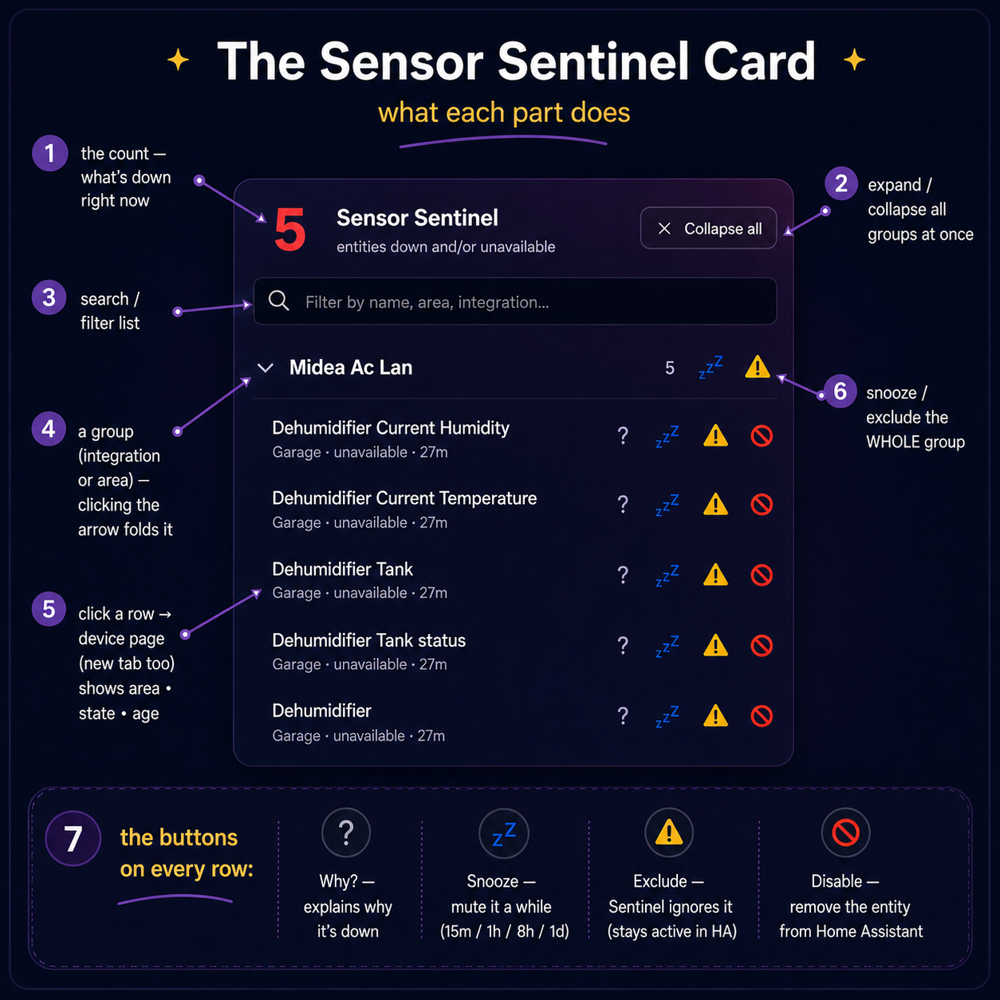

# Sensor Sentinel

A **performance-safe, event-driven watchdog** for Home Assistant that answers
one question well: **"what's unavailable right now, and why?"** — across your
whole fleet, without ever rescanning every entity on every state change.

> **Built to stay invisible.** Most "unavailable entities" helpers rescan every
> entity on every state change, which can bog Home Assistant down on a large
> setup. Sensor Sentinel tracks changes incrementally — one scan at startup,
> then near-zero work per event — so it stays light even across thousands of
> entities.

It ships with a companion Lovelace card, so once it's installed you get a live,
grouped, actionable list of everything that's down — with one-click snooze,
exclude, disable, and Z-Wave ping.



---

## Contents

- [Why a custom integration](#why-a-custom-integration)
- [Features](#features)
- [Install](#install)
- [Using the card](#using-the-card)
- [Configuration](#configuration)
- [Entities](#entities)
- [Events](#events)
- [Services](#services)
- [How it stays fast](#how-it-stays-fast)
- [Good to know](#good-to-know)
- [Troubleshooting the card](#troubleshooting-the-card)
- [License](#license)

---

## Why a custom integration

A template sensor can only poll or scan-per-event — neither is acceptable at
several thousand entities. An add-on can't cleanly reach the entity/device
registry. A custom integration listens on the event bus, keeps an incremental
set, enriches from cached registry maps, and exposes clean entities, events, and
services.

## Features

### Detection

- **Incremental** — a single bus listener maintains the down-set. No fleet-wide
  scan on any event; sensor attribute payloads are hard-capped.
- **Grace window** — a per-entity debounce (default 60s) suppresses flaps: an
  entity must stay bad past the window before it counts as an incident.
- **Startup warmup** — nothing is counted until a warmup window (default 120s)
  after boot, so transient boot-time unknowns (MQTT retained values, Z-Wave
  interviews, device trackers) don't spike the count or `recovered_today`.
  Whatever is still bad when the window ends is recorded as down.
- **Silent devices (opt-in)** — catches the failure the state check can't see: a
  battery device that dies but never goes `unavailable`. A sleeping Z-Wave node
  is never sent anything, so it is never marked dead, and its contact keeps
  reading "closed" at 100% battery indefinitely. With **Flag devices not heard
  from in** set, any device whose `last_seen` sensor is older than that is
  raised as one incident, named after the device, with its last reported
  battery. It clears as soon as the device is heard from again. Only
  **battery** devices are checked: mains devices aren't polled and can sit
  quiet for days when nobody uses them (see dead nodes, next).
- **Dead Z-Wave nodes** — a node the Z-Wave JS driver has marked dead (its
  `Node status` sensor reads `dead`) is flagged like any unavailable entity,
  named after the device, and clears when the node comes back. The driver only
  notices a dead node when a message to it fails, though, and nothing ever
  sends a repeater or an idle plug anything, so one can sit dead while still
  reading `alive`. With **Ping quiet mains Z-Wave nodes every** set (opt-in),
  Sentinel pings each mains node it hasn't heard from in that many hours, at
  most once per interval and a few per 5-minute tick. A dead one fails the
  ping, flips to `dead`, and is flagged.
- **Durable** — incident start-times and snoozes persist across restarts, so
  durations and the trend sparkline survive a reboot.

### Exclusions

- **Rules, not lists** — exclude by **domain**, **integration**, **entity_id
  glob** (e.g. `*_firmware`), or **explicit entity**, all from the UI. No
  hand-edited YAML.
- **Dry-run preview** — before saving a rule change, see exactly which
  currently-down entities it would silence, so you never over-exclude blindly.
- **Disabled entities are ignored** — an entity disabled in the registry is
  dropped immediately, even if it lingers in the state machine until its
  integration reloads.

### Notifications

- **Grouped & debounced** — a burst of drops becomes one message, rolled up by
  integration, plus recovery notices. Sent to your mobile app and/or as a
  persistent notification.
- **Re-alert** (opt-in) — optionally re-notify when something is *still* down
  after N hours.

### Self-healing & housekeeping (opt-in, off by default)

- **Auto-recovery** — try to heal a stuck entity: ping Z-Wave nodes, or reload
  the owning integration, with attempt caps and cooldowns.
- **Stale-retire** — automatically drop long-dead incidents (retired devices)
  from the count after N days; they stay visible, flagged, in the card.

### Companion Lovelace card

Bundled and auto-registered — no separate install or resource setup — with a
**visual editor** (no YAML). It shows the **full** live incident list (fetched
on demand via a websocket command, so the sensor attribute stays capped no
matter how many entities are down). See [Using the card](#using-the-card).

### Automation surface

`sensor_sentinel.entity_down` / `entity_recovered` / `entity_still_down` bus
events carry full context for your own automations. See [Events](#events).

## Install

1. **HACS → ⋮ → Custom repositories** → add this repo, category **Integration**.
2. Install **Sensor Sentinel**, then **restart Home Assistant**.
3. **Settings → Devices & Services → Add Integration → Sensor Sentinel**.
4. Add the card to a dashboard: **Add Card → Custom: Sensor Sentinel Card**.

## Using the card

Incidents are grouped (by integration or area) and sorted (by count or name).
Silent devices (see [Detection](#detection)) always get their own group,
**Silent - Check Battery**, pinned first and listed longest-silent first, with
no reload button since a reload can't fix a battery. Each group and the header
have controls ([see the annotated card
above](#sensor-sentinel)):

**Header**

- **Count** — number of entities currently down.
- **Expand all / Collapse all** — toggle every group at once. Expanding or
  collapsing a group sticks across reloads for as long as that group still has
  incidents; once it clears, the group goes back to whatever **Collapse groups
  by default** is set to, so a fresh incident doesn't reappear pre-expanded.
- **Search** — filter the list by name, area, or integration.
- **Trend sparkline** *(optional)* — the down-count over the last N hours, from
  recorder history.

**Each incident row** — click the row to open the entity's **device page** (a
real link, so right-click / cmd-click / middle-click open it in a new tab), plus
action buttons:

| Button | Action |
| --- | --- |
| **?** | **Why?** — a dialog explaining the entity's status (down since, current state, matched exclusion rule, …). |
| **📡** | **Ping** the Z-Wave node (`zwave_js.ping`) to wake it — shown on Z-Wave rows only. |
| **💤** | **Snooze** — mute the entity for a preset (15m / 1h / 8h / 1d). |
| **⚠️** | **Exclude** — add a Sentinel rule so it's never reported. Stays active in HA; undo in **Configure**. |
| **🚫** | **Disable** — disable the entity in Home Assistant entirely (removed until you re-enable it in Settings → Entities). |

Group headers offer **snooze-all** and **exclude-all** for everything in the
group, plus — for integration groups — a **reload** button that reloads that
integration (often the quickest fix when a whole integration has gone dark).
Snooze, exclude, disable, and reload all open a confirmation dialog first.

**Card options** (visual editor): count entity, group by *integration/area*,
sort by *count/name*, collapse groups by default, show the Z-Wave ping button,
show the per-group reload button, and the trend sparkline window in hours
(0 = off).

## Configuration

Everything lives in the integration's **Configure** dialog. Each field has
inline help text.

| Setting | Default | What it does |
| --- | --- | --- |
| **Bad states** | `unavailable`, `unknown` | Which states count as "down". |
| **Excluded domains** | `button, event, group, image, input_button, input_text, remote, scene, stt, tts` | Whole domains to never report (where `unknown` is normal). |
| **Excluded integrations** | — | Whole integrations to never report. Picked from what's present in your system. |
| **Excluded entity_id globs** | — | Patterns like `*_firmware`, `roborock_*`. |
| **Excluded entities** | — | Specific entities to never report. |
| **Grace window** | 60s | How long an entity must stay bad before it's reported. |
| **Startup warmup** | 120s | Hold boot-time bad entities before counting them. |
| **Integration rollup threshold** | 5 | Collapse a burst from one integration into a single rolled-up incident. |
| **Re-alert if still down after** | 0 (off) | Re-notify after this many hours. |
| **Auto-retire incidents after** | 0 (off) | Drop incidents down longer than this many days. |
| **Flag devices not heard from in** | 0 (off) | Raise a *silent* incident for a device whose `last_seen` is older than this many hours. 48 suits most battery sensors; allow at least twice the device's wake-up interval. |
| **Devices exempt from the silent check** | — | Devices that are legitimately quiet, such as button remotes. |
| **Ping quiet mains Z-Wave nodes every** | 0 (off) | Ping mains nodes not heard from in this many hours so a dead one gets marked and flagged. 24 suits most homes. |
| **Automatic recovery** | off | Try to heal stuck entities (ping / reload) with guardrails — see below. |
| **Recovery delay** | 300s | How long down before the first recovery attempt. |
| **Notification targets** | — | `notify.*` service names (without the `notify.` prefix). |
| **Persistent notifications** | on | Also create in-HA persistent notifications. |

### How auto-recovery decides to stop

Z-Wave entities get a `zwave_js.ping`, which affects nothing else. Everything
else falls back to reloading the owning config entry — a blunt instrument, since
it restarts *every* entity that entry owns.

So attempts are budgeted, and the budget is spent on failure and refunded the
moment the entity comes back:

- **A reload that works costs nothing.** Integrations that genuinely recover
  this way keep recovering, indefinitely.
- **A reload that changes nothing is not retried forever.** Three attempts, or
  **one** if the entry still has working entities — because reloading nine
  healthy speakers to chase one that is switched off is not worth a second
  guess. It resumes if the entity ever recovers on its own.

A reload is dispatched **once per config entry per pass**, however many of its
entities are down — one offline device with fourteen entities triggers one
reload, not fourteen — and every one of those entities still counts the attempt,
so they can't take turns reloading the entry on later passes.

When the budget runs out Sentinel logs that it is giving up, and why, at `info`.
An entity that is offline because it is *off* — a battery speaker on its charger,
a seasonal device — is best handled with an exclusion rule rather than left for
auto-recovery to discover.

## Entities

| Entity | Purpose |
| --- | --- |
| `sensor.sentinel_unavailable_count` | Live down-count. Attributes: `by_integration`, `by_area`, a capped 25-row sample, `recovered_today`, `longest_down`, `stale_count`. |
| `binary_sensor.sentinel_problem` | `device_class: problem` — on when anything is down. |
| `sensor.sentinel_recovered_today` | Entities recovered so far today (resets at local midnight). |
| `sensor.sentinel_longest_down` | Name of the entity down the longest; `entity_id` / `since` in attributes. |

## Events

| Event | Data |
| --- | --- |
| `sensor_sentinel.entity_down` | `entity_id, state, name, integration, device, device_id, area, since, battery, flapping, stale, reason` — plus `last_seen, silent_for_hours` when `reason` is `silent` |
| `sensor_sentinel.entity_recovered` | `entity_id, name, reason, device_id` |

`reason` is `state` for an unavailable/unknown entity, `silent` for a device
that stopped reporting, and `dead` for a Z-Wave node the driver marked dead. Existing automations keep working unchanged; filter on
`reason` if you want to treat the two differently.
| `sensor_sentinel.entity_still_down` | incident fields + `down_seconds` (fired by the opt-in re-alert) |

## Services

| Service | Description |
| --- | --- |
| `sensor_sentinel.snooze` | Mute an entity for N minutes. If it's still down when the snooze lapses, it resurfaces on its own (within the ~5-minute housekeeping tick). |
| `sensor_sentinel.unsnooze` | Clear a snooze. |
| `sensor_sentinel.exclude` | Add a permanent explicit-entity exclusion. |
| `sensor_sentinel.explain` | Return why an entity is flagged / excluded (service response). |

## How it stays fast

- One `hass.states` scan at startup to seed the set; never again.
- Per event: a state-set membership test and, at most, an O(rules) exclusion
  check — and only for entities that are bad or already tracked.
- Registry enrichment (name / device / area) happens per *incident* (post-grace),
  not per event, off cached registry maps refreshed only on registry updates.
- Sensor writes are coalesced (≤1/sec) so a flapping storm can't thrash Core.
- The full incident list is served on demand over a websocket command, so the
  sensor's attribute payload never grows unbounded.
- The silent-device check adds no listeners and touches only devices that have a
  `last_seen` sensor, once per housekeeping tick (every 5 minutes). The hot path
  pays one empty-dict check unless a silent incident is live.
- The dead-node check is one extra set lookup, and only for entities whose state
  is literally `dead`. The probe sends at most 5 pings per 5-minute tick, each
  node at most once per interval, and skips any node heard from recently.

## Good to know

- **Exclude vs. Disable** — *Exclude* only tells Sentinel to ignore an entity;
  it stays fully active in HA. *Disable* removes the entity from Home Assistant
  entirely (re-enable it in Settings → Entities). Use exclude for noise, disable
  for entities you truly don't want.
- **Just disabled something and it's still listed?** Disabling an entity leaves
  it in the state machine as `unavailable` until its integration reloads (e.g.
  Z-Wave JS). Sentinel drops disabled entities on sight, and a reload/restart
  clears them from HA for good.
- **Silent-device check: what it reads.** Z-Wave JS devices expose a
  `Last seen` diagnostic sensor. It is **disabled by default on some installs**,
  and a device whose sensor is disabled isn't checked, so enable the ones you
  care about. Zigbee2MQTT devices are covered once Z2M's `last_seen` option is
  on and the `Last seen` sensor is enabled. Other "last seen" sensors (BLE
  presence trackers and the like) are deliberately ignored.
- **Silent-device check: what it honours.** Entity, glob, integration and snooze
  exclusions apply. *Domain* exclusions don't: they exist because `unknown` is a
  normal state for buttons and events, which says nothing about whether the
  device is alive. Exempt quiet devices (remotes) with **Devices exempt from the
  silent check**. A device that already has an unavailable entity is reported
  by that incident alone, not twice, and auto-recovery never acts on a silent
  device (a reload can't change a battery).
- **Dead-node check: what it needs.** The `Node status` diagnostic sensor
  (enabled by default in Z-Wave JS). Exclude a node's `Node status` entity to
  stop both the dead check and the probe for that node. Auto-recovery, when on,
  pings dead nodes too, since a successful ping is what revives them. A Z-Wave
  JS restart resets every node to `alive`, so a dead node reappears only once
  something (the probe, an automation) tries to reach it again.
- **Count looks high right after a restart?** That's the startup warmup settling
  — boot-time transients clear within the warmup window.

## Troubleshooting the card

The card is served by the integration itself at
`/sensor_sentinel/sensor-sentinel-card.js?v=<version>` and auto-loaded on every
dashboard (via the frontend's extra-module mechanism, not the Lovelace
resources list — so you won't see it under **Settings → Dashboards →
Resources**; that's normal).

If a dashboard shows a red **"Configuration error"** where the card should be:

1. **Hard-refresh the browser / clear the frontend cache.** On the HA mobile
   app: **Settings → Companion app → Debugging → Reset frontend cache**. Stale
   cached copies are by far the most common cause.
2. **Verify the module is being served.** Open
   `http://<your-ha>:8123/sensor_sentinel/sensor-sentinel-card.js` — you should
   get JavaScript, not a 404. A 404 means the integration didn't finish loading;
   check **Settings → System → Logs** for `sensor_sentinel` errors.
3. **Check the card's own error log.** The card records render failures to the
   browser's localStorage (they don't appear in HA's backend logs). In the
   browser console on the affected device, run:

   ```js
   JSON.parse(localStorage.getItem("sensor-sentinel-error-log") || "[]")
   ```

   and include the output when filing an issue.
4. **Manual fallback registration.** If a device stubbornly refuses to load the
   module automatically, add it explicitly under **Settings → Dashboards → ⋮ →
   Resources → Add resource** with URL
   `/sensor_sentinel/sensor-sentinel-card.js` and type **JavaScript module**.
   (Harmless alongside the auto-registration — the card guards against being
   defined twice.)

## Status

Actively developed. Auto-recovery, re-alert, stale-retire, the silent-device
check and the Z-Wave probe are **opt-in** and conservative (off by default), so the integration
never acts on your system unless you ask it to.

## License

MIT
